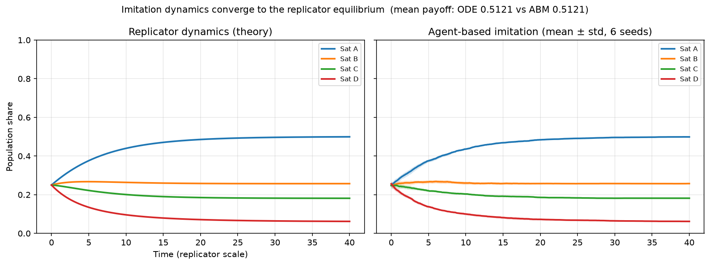
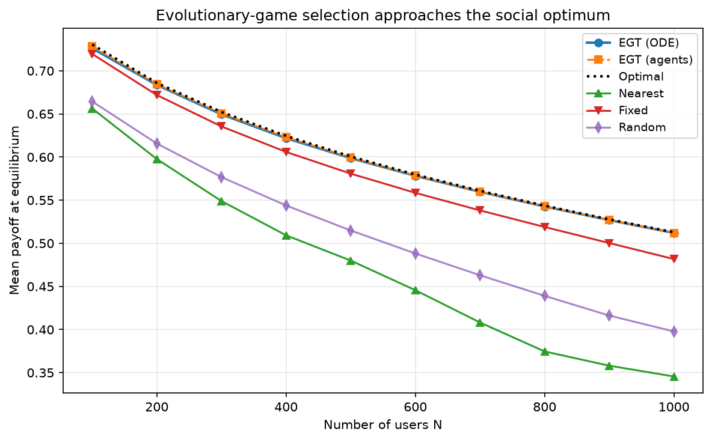
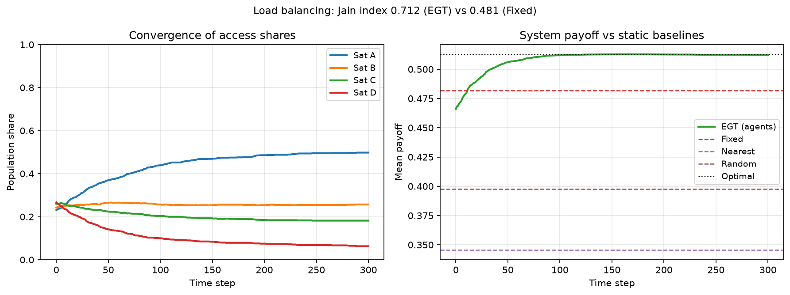
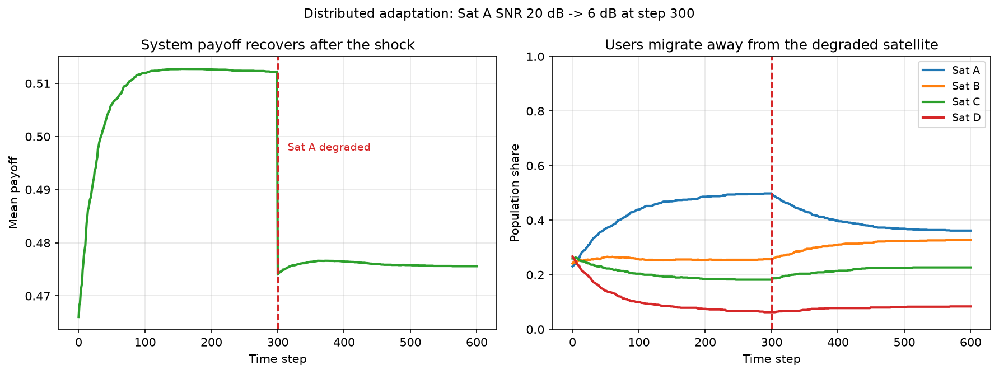

# egtsat — Evolutionary-Game Satellite Selection

A small, self-contained Python package that demonstrates **evolutionary game
theory applied to LEO-satellite access selection**: a population of ground
users repeatedly chooses which satellite to connect to, and two distributed
decision mechanisms — the **replicator dynamics** (population-level theory)
and **pairwise-comparison imitation** (agent-level algorithm) — drive the
population toward an equilibrium that balances **capacity, queueing delay and
trust**.

This is an **independent educational implementation of textbook material**
(replicator dynamics, M/M/1 queues, Shannon capacity). It is not the official
code of any publication. See [References](#references) for the classical
texts behind every model used here.


## Why this exists

"How should 1000 distributed users pick one of a few heterogeneous satellites
without a central controller, without flooding the good satellite, and without
trusting it blindly?" Evolutionary game theory gives a clean answer, yet
open, runnable, well-tested implementations of that answer are rare. This
repository fills that gap with ~600 lines of documented code and four
reproducible experiments.

## How it works

Each satellite offers a **payoff** built from three normalized components
(all mapped to `[0, 1]` with half-saturation functions `s/(s+half)`):

```
U_i(x) = w_c · capacity_i(x) + w_d · delay_i(x) + w_t · trust_i
```

- **capacity** — per-user Shannon rate `R_i / (1 + x_i·N)`, so a satellite
  gets worse for everyone as it gets crowded;
- **delay** — M/M/1 mean sojourn time `1/(μ_i − λ_i)` with
  `λ_i = x_i·N·λ_user`, clamped at the stability boundary `λ = (1−ε)μ`
  (queue instability is a model boundary, not a numerical accident);
- **trust** — an exogenous reputation score per satellite.

`x` is the vector of population shares. Two update processes act on `x`:

| Process | Update rule | Role |
|---|---|---|
| Replicator dynamics | `dx_i/dt = x_i (U_i − Ū)` | theory: ODE integrated numerically |
| Agent-based imitation | each user samples a random model user and switches with probability `β·(U_j − U_cur)⁺` | distributed algorithm anyone can run |

The mean-field limit of the imitation rule **is** the replicator equation
(the positive and negative parts of the pairwise differences cancel exactly),
so the simulated agents must — and do — converge onto the ODE trajectory.
Experiment 1 verifies this; `tests/test_game.py` asserts it in CI.

## Quickstart

```bash
git clone https://github.com/futation/evolutionary-game-satellite-selection
cd evolutionary-game-satellite-selection
pip install -e .[dev]

pytest            # 12 property tests, < 1 s
python experiments/exp1_convergence.py    # regenerate all figures into figures/
```

Minimal example:

```python
import numpy as np
from egtsat import default_scenario, make_payoff, simulate_game, solve_replicator

scenario = default_scenario()          # 4 heterogeneous LEO satellites, N = 1000
payoff = make_payoff(scenario)
x0 = np.full(scenario.m, 0.25)

t, trajectory = solve_replicator(x0, payoff)             # theory
result = simulate_game(x0, payoff, num_agents=1000)      # distributed algorithm
print(result.final_proportions)                          # ≈ trajectory[-1]
```

## Experiments

All figures are generated by the scripts in `experiments/` — no hand-drawn
results.

| Figure | What it shows |
|---|---|
|  | **Validation.** Imitation dynamics (right, mean ± std over 6 seeds) land on the replicator ODE (left); final mean payoff identical to 4 decimals. |
|  | **Near-optimality.** Across user counts N = 100…1000, the game equilibrium tracks the social optimum (dotted) and stays far above nearest/fixed/random selection; the gap widens with congestion. |
|  | **Load balancing.** Access shares converge; Jain index 0.712 vs 0.481 for the "everyone piles on the best satellite" baseline. |
|  | **Adaptation.** When the best satellite suddenly degrades, users migrate and system payoff settles at the *new* environment's social optimum — with no central controller. |

## Repository layout

```
src/egtsat/
├── config.py      # Satellite & Scenario dataclasses, default 4-satellite scenario
├── utility.py     # capacity / M/M/1 delay / trust → unified payoff function
├── replicator.py  # replicator ODE (scipy.solve_ivp)
├── game.py        # agent-based pairwise-comparison imitation
├── baselines.py   # social optimum (SLSQP), nearest, fixed, random
└── metrics.py     # Jain index, load CV, mean payoff
experiments/       # exp1–exp4, each regenerates one figure
tests/             # property tests incl. the mean-field validation
```

## Extending

- Swap any payoff component — everything is a function of the share vector `x`
  (and time, for time-varying environments: see `exp4` and `make_payoff(snr_of_t=...)`).
- Plug in a dynamic reputation model through `simulate_game(reputation=...,
  reputation_step=...)` and `make_payoff(trust_of_t=...)`.
- Scale to more satellites: the payoff is vectorized over `M`; try
  `Scenario(satellites=(...))` with 8 or 16 entries.

Roadmap ideas: an ergodic-secrecy-capacity component, real orbit propagation
for `d_i(t)`, a reputation-EMA demo experiment.

## References

- J. Hofbauer & K. Sigmund, *Evolutionary Games and Population Dynamics*, Cambridge University Press, 1998.
- J. W. Weibull, *Evolutionary Game Theory*, MIT Press, 1995 (ch. 5 for imitation dynamics).
- J. Björnerstedt & J. W. Weibull, "Homo economicus and homo sociologicus: an elementary cartoon," in *The Rational Foundations of Economic Behaviour*, 1996 — the pairwise-imitation ⇒ replicator result.
- L. Kleinrock, *Queueing Systems, Vol. 1*, Wiley, 1975 (M/M/1).
- Related public work on game-theoretic satellite selection:
  [LEO handover via group & evolutionary game (2018)](https://jns.nju.edu.cn/EN/Y2018/V54/I4/855) ·
  [Cybertwin-assisted mode selection in ultra-dense LEO networks](https://www.researchgate.net/publication/366842756_Cybertwin_Assisted_Mode_Selection_in_Ultra_Dense_LEO_Integrated_Satellite_Terrestrial_Network) ·
  [GT4Satellite: game theory for satellite networks (paper collection)](https://github.com/jwwthu/GT4Satellite).

## License

[MIT](LICENSE)
